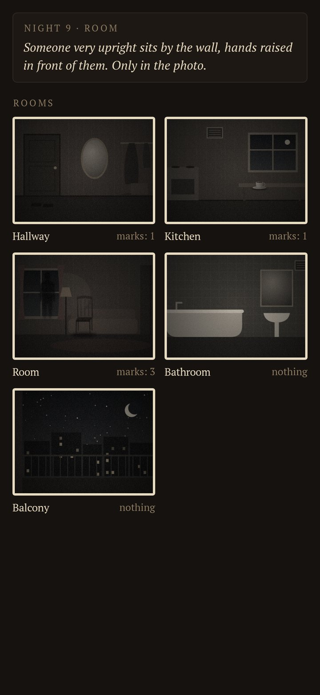
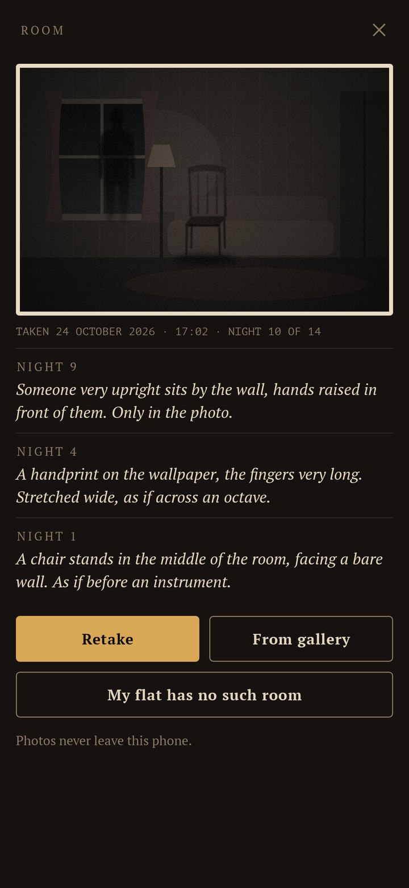
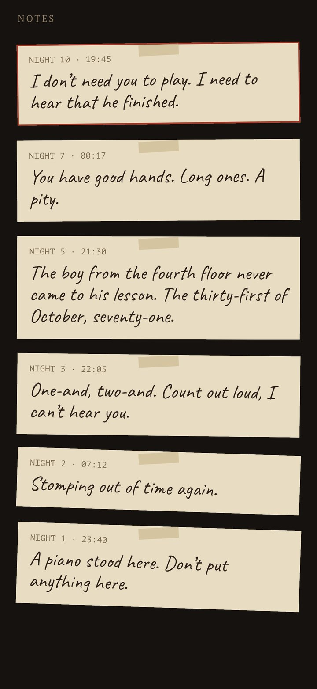
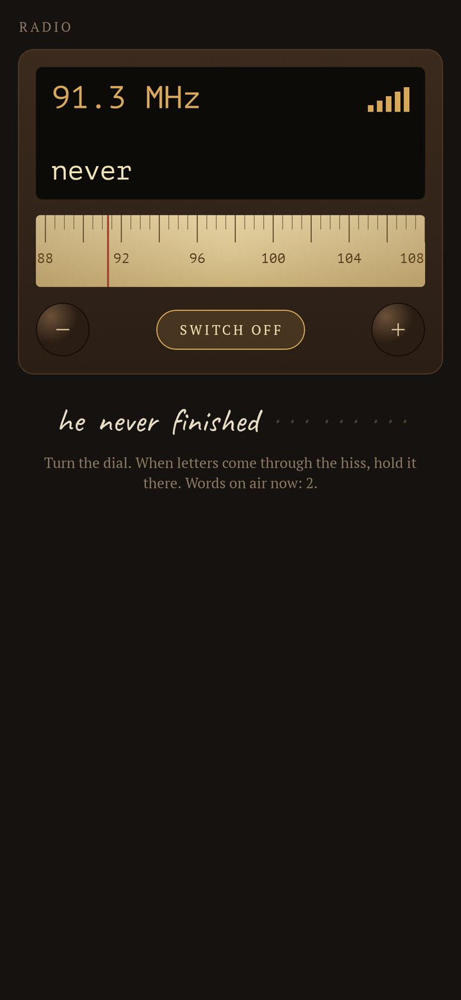
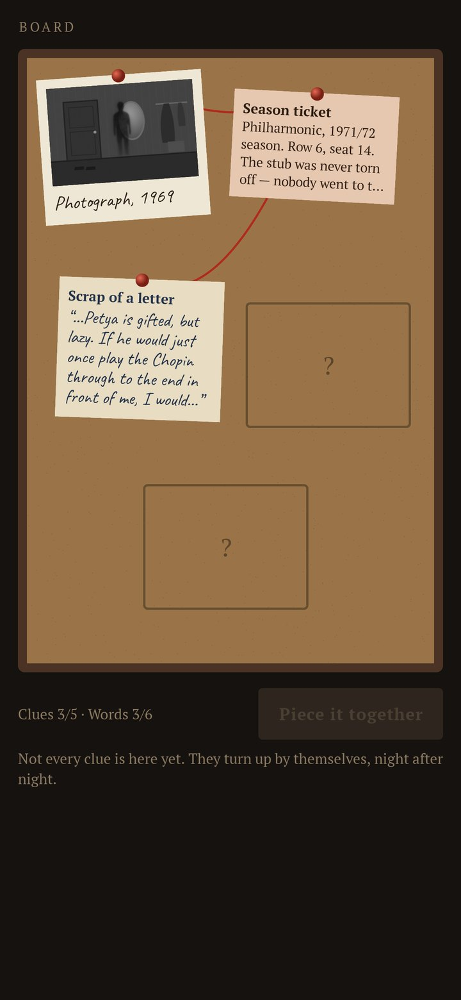
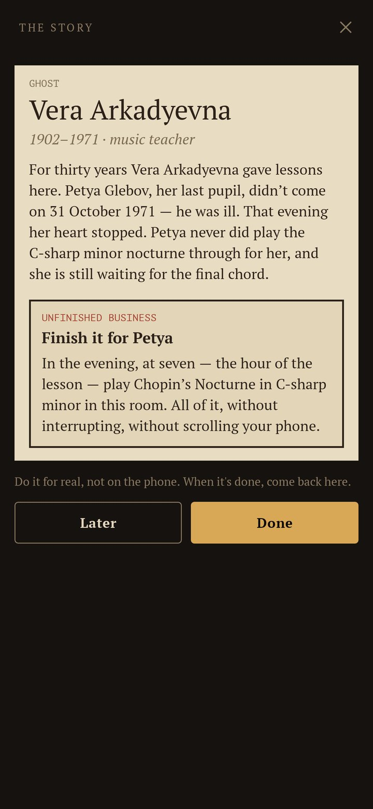

<div align="center">


# Lodger

### Someone already lives in your flat. Find out who — and help them leave.

*A slow, quiet haunting on your own photos. You photograph your rooms; every evening someone leaves a mark in them — shoe prints across the hallway, a chair that wasn't there, breath on the mirror, a dark shape by the sofa that is only in the picture. Notes arrive in the evening, words come through the static of an old radio, clues pin themselves to a cork board. Two weeks later the story comes together, and there is one real thing to do so the lodger can finally go. Free, no ads, no account, no internet.*

[](https://github.com/bigdevwhale/lodger/actions/workflows/android.yml)
[](https://github.com/bigdevwhale/lodger/releases/latest)


[](LICENSE)

**English** · [Русский](README.ru.md) · [Changelog](CHANGELOG.md)

     

</div>

---

## How it works

1. **Photograph your rooms.** Hallway, kitchen, room, bathroom, balcony — as they look in the evening, with the phone's own camera (or from the gallery). Two are enough; a room you don't have can be crossed out, and its marks go next door. The photos never leave the phone.
2. **Someone moves in.** Each lodger stays fourteen nights. The night turns at six in the evening.
3. **Marks on your photos.** Every few nights something turns up in a room: dusty shoe prints with a tread, wet footprints, a cat's paw trail, crumbs laid out in a horseshoe, a handprint on the mirror, a word written in breath on the glass, frost in October, a door gap darker than it should be, eyes under the sofa, a shadow standing where no one stands. Marks are painted into the picture itself — the app reads each photo for its darkest corner, its glass, its stretch of floor — and a new one develops slowly when you open the room.
4. **Notes.** The lodger writes — grumpy, frightened, polite, seven years old. Notes arrive as an evening notification; one written at three in the morning still waits for the evening.
5. **The radio.** Turn the dial through live static; near a voice the hiss thins and letters come through. Hold there and the word is caught, spoken low by the phone's own voice. New words come on air every couple of nights, and together they make one sentence.
6. **The board.** Photographs, letters, tickets, records and objects pin themselves to a cork board, tied with red thread.
7. **The story, and the one thing left undone.** With every clue and every word, the story comes together: who they were and why they stayed. Then a real task — play a nocturne at seven, write a letter by hand and post it, invite someone round, look at the sky for ten minutes, give a nameless cat a name. Do it, tap "Done", and they go.
8. **The house register.** The flat stands empty for three nights, then someone else moves in. Ten lodgers: a music teacher, a house spirit nobody invited along, a game of hide-and-seek that never ended, a reflection still waiting since June 1941, a postman with one undelivered letter, a kikimora living in an unfinished scarf, the whisperer in the ventilation shaft, the astronomer upstairs who missed Halley's comet, a hostess setting a table for twelve, and a cat who was never named.
9. **How frightening.** Candle (quiet), Lantern (the odd knock, photos that waver as if the lamp were failing) or Full moon (on a photo you may glimpse, for a blink, whoever stands there). The phone is silent at night.

## Build

```
./gradlew testDebugUnitTest assembleDebug
./gradlew -Pdemo assembleDebug          # app.lodger.demo: the first lodger ten nights in, drawn rooms for photos
./gradlew testDebugUnitTest -Prender --tests '*RenderArt*'   # screens (EN/RU) and every mark to app/build/art
./gradlew testDebugUnitTest -Prender --tests '*RenderArtMarks*' -Pphoto=/path/to/room.jpg   # try the marks on a real photo
```

The stories are `app/src/main/assets/lodgers/{en,ru}.json`, checked against each other by `ContentTest`. Marks are painted in `ui/art/Ink.kt`; the static, the knocks and the creaks are synthesised.

Fonts: PT Serif and PT Mono (ParaType), Caveat (Impallari Type) — all SIL Open Font License.
