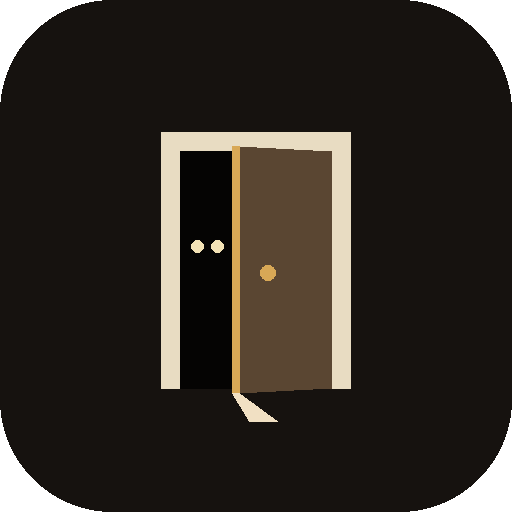
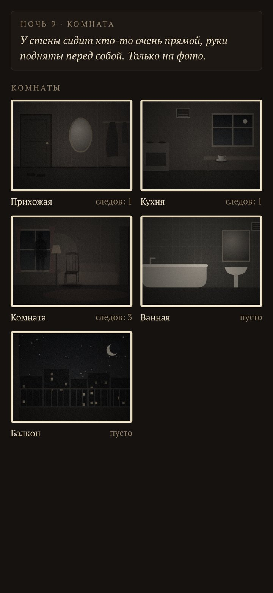
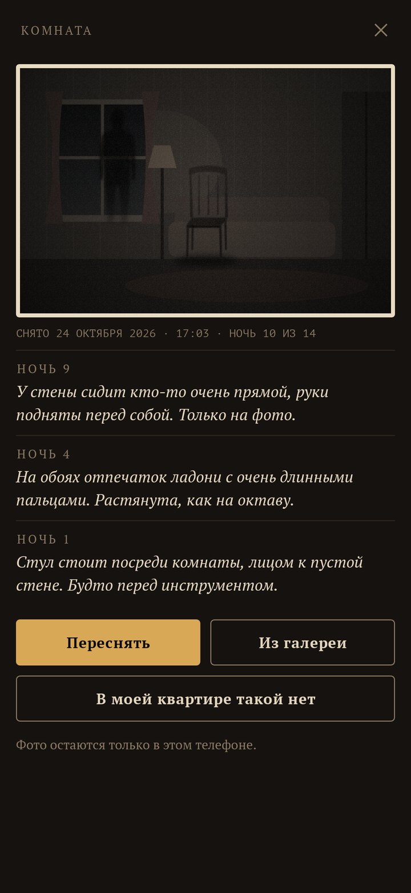
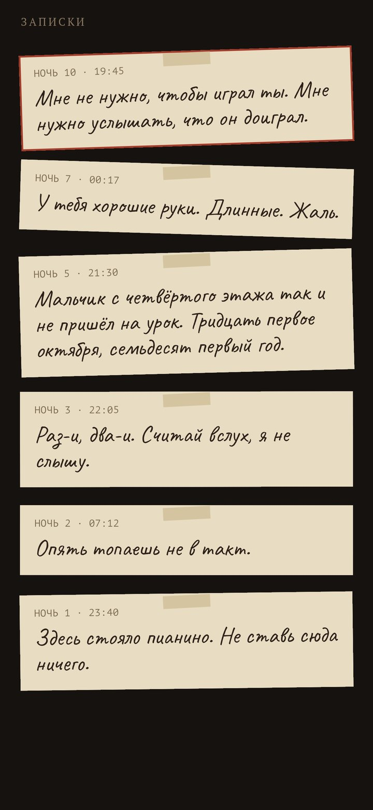
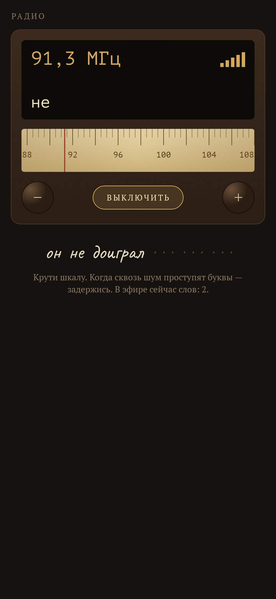
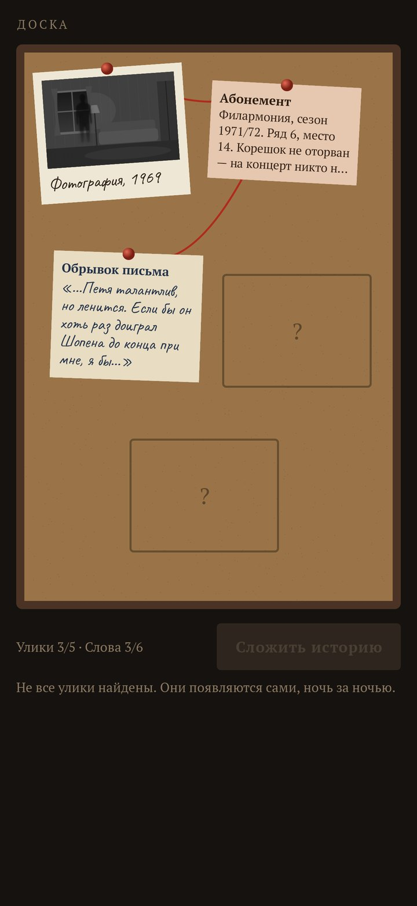
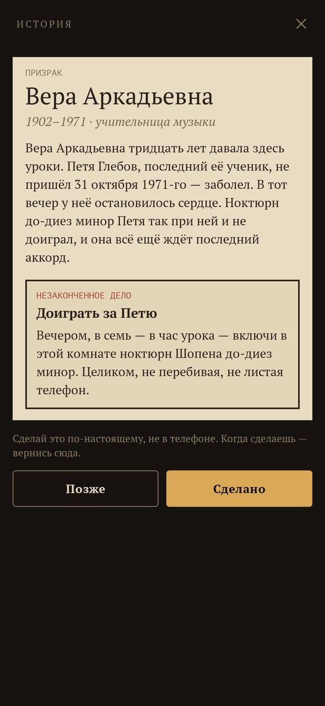

<div align="center">



# Lodger

### В твоей квартире уже кто-то живёт. Узнай, кто, — и помоги ему уйти.

*Тихая, медленная жуть на твоих собственных фото. Ты фотографируешь комнаты, и каждый вечер в них кто-то оставляет след: отпечатки туфель через прихожую, стул, которого не было, дыхание на зеркале, тёмный силуэт у дивана — только на снимке. Вечером приходят записки, сквозь шум старого радио пробиваются слова, на пробковой доске появляются улики. Через две недели история складывается — и остаётся одно настоящее дело, чтобы жилец наконец смог уйти. Бесплатно, без рекламы, без аккаунта и без интернета.*

[](https://github.com/bigdevwhale/lodger/releases/latest)

[English](README.md) · **Русский** · [Изменения](CHANGELOG.md)

     

</div>

---

## Как это устроено

1. **Сфотографируй комнаты.** Прихожая, кухня, комната, ванная, балкон — такими, какие они вечером, обычной камерой телефона (или из галереи). Хватит двух; комнату, которой нет, можно вычеркнуть — её следы уйдут в соседнюю. Фото никуда не уходят из телефона.
2. **Кто-то въезжает.** Каждый жилец живёт четырнадцать ночей. Ночь начинается в шесть вечера.
3. **Следы на твоих снимках.** Раз в пару ночей в комнате что-то появляется: пыльные следы подошв с протектором, мокрые следы, кошачья цепочка, крошки подковой, ладонь на зеркале, слово, выведенное по запотевшему стеклу, иней в октябре, щель двери темнее, чем нужно, глаза под диваном, тень там, где никто не стоит. Следы вписываются в сам снимок — приложение находит на фото самый тёмный угол, стекло, полосу пола — а новый проявляется медленно, когда открываешь комнату.
4. **Записки.** Жилец пишет — ворчливо, испуганно, вежливо, как семилетний ребёнок. Записки приходят вечерним уведомлением; написанная в три часа ночи всё равно дождётся вечера.
5. **Радио.** Крути шкалу сквозь живой шум; рядом с голосом шипение стихает и проступают буквы. Задержись — слово поймано, и телефон тихо его произносит. Новые слова выходят в эфир раз в пару ночей и вместе складываются в одну фразу.
6. **Доска.** Фотографии, письма, билеты, справки и вещи сами прикалываются к пробковой доске, связанные красной ниткой.
7. **История и одно незаконченное дело.** Когда собраны все улики и все слова, история складывается: кем был жилец и почему остался. А потом — настоящее дело: включить ноктюрн в семь вечера, написать письмо от руки и отправить, позвать кого-нибудь в гости, десять минут смотреть на небо, дать безымянному коту имя. Сделай, нажми «Сделано» — и он уйдёт.
8. **Домовая книга.** Три ночи квартира пустует, потом въезжает следующий. Десять жильцов: учительница музыки, домовой, которого забыли позвать при переезде, прятки, которые так и не закончились, отражение, ждущее с июня 1941-го, почтальон с одним недоставленным письмом, кикимора в недовязанном шарфе, шептун из вентиляции, астроном сверху, не увидевший комету Галлея, хозяйка, накрывавшая на двенадцать, и кот без имени.
9. **Насколько страшно.** Свеча (тихо), Фонарь (иногда стучат, снимки подрагивают, как от лампы) или Полнолуние (на снимке можно на миг увидеть того, кто там стоит). Ночью телефон молчит.

## Сборка

```
./gradlew testDebugUnitTest assembleDebug
./gradlew -Pdemo assembleDebug          # app.lodger.demo: первый жилец на десятой ночи, нарисованные комнаты вместо фото
./gradlew testDebugUnitTest -Prender --tests '*RenderArt*'   # экраны (EN/RU) и все следы в app/build/art
```

Истории — `app/src/main/assets/lodgers/{en,ru}.json`, их сверяет `ContentTest`. Следы рисуются в `ui/art/Ink.kt`; шум радио, стуки и скрип синтезируются.

Шрифты: PT Serif и PT Mono (ParaType), Caveat (Impallari Type) — SIL Open Font License.
